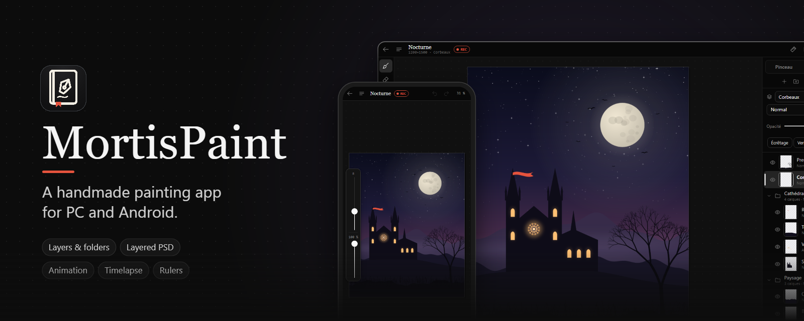
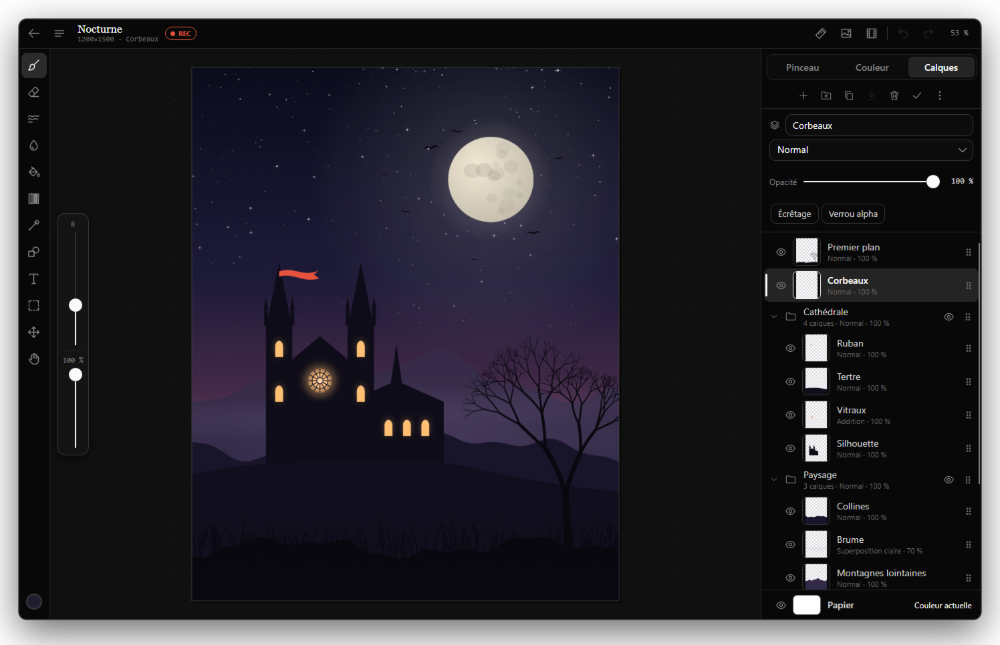
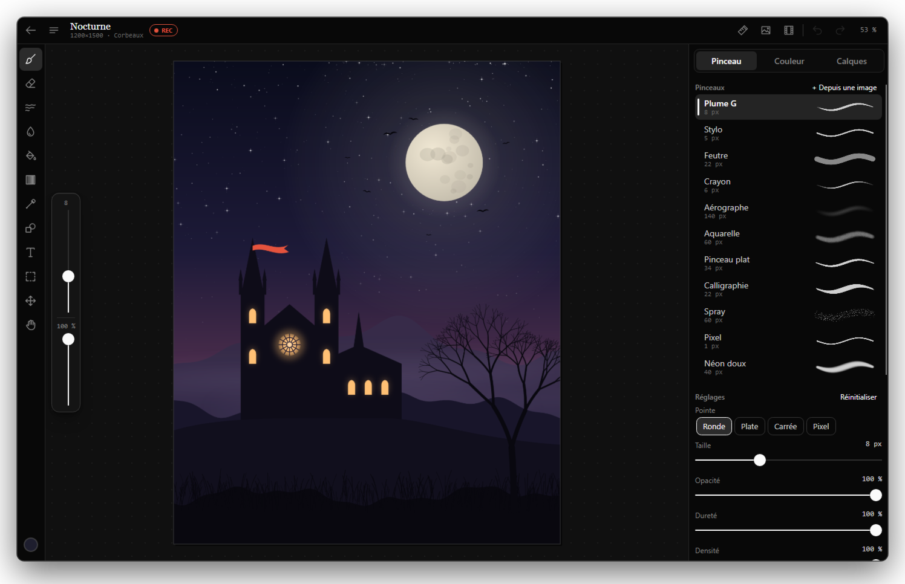
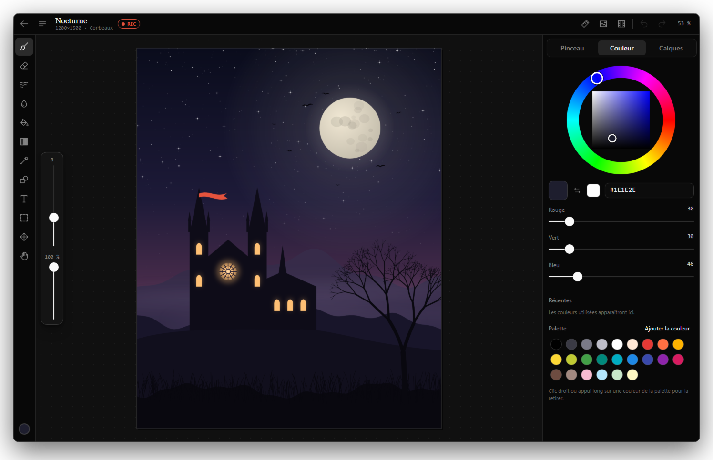
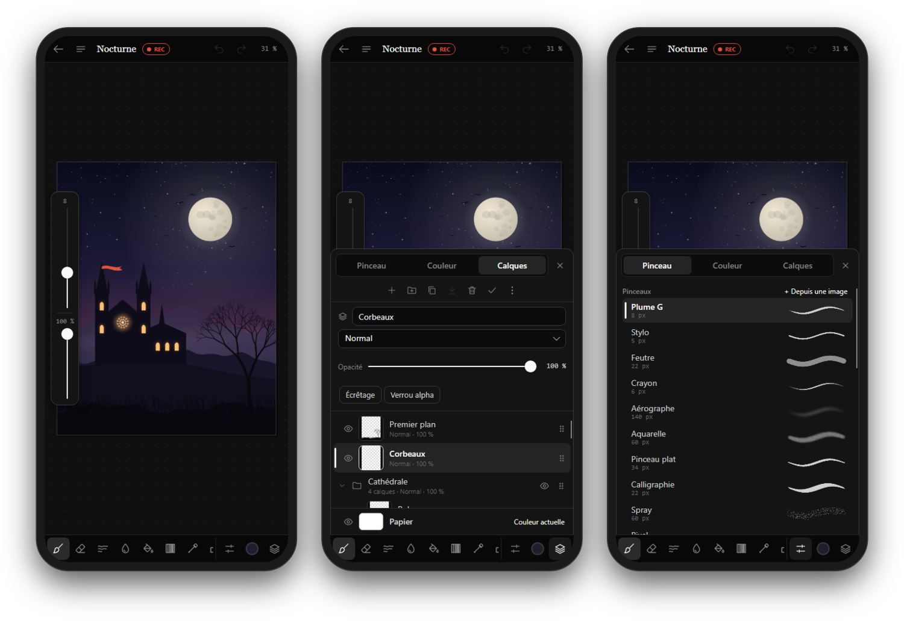
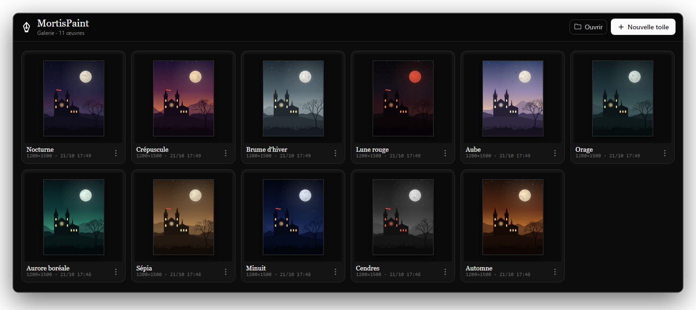

<p align="center">
  
</p>

<p align="center">
  <a href="https://github.com/Nekuzaky/MortisPaint/releases/latest"></a>
  
  
  
  
  <a href="LICENSE"></a>
</p>

<p align="center">
  <b>A handmade painting app inspired by ibisPaint</b>, "premium" features included.<br>
  Layers and folders, layered PSD for ibisPaint and Photoshop, animation, timelapse. One C# code base for PC and Android.
</p>

<p align="center">
  <a href="https://github.com/Nekuzaky/MortisPaint/releases/latest"><b>Download for Windows</b></a> ·
  <a href="#features">Features</a> ·
  <a href="#ibispaint-compatibility">ibisPaint compatibility</a> ·
  <a href="#build-from-source">Build from source</a> ·
  <a href="CHANGELOG.md">Changelog</a>
</p>

<p align="center">
  
</p>

<table>
  <tr>
    <td width="50%"></td>
    <td width="50%"></td>
  </tr>
  <tr>
    <td align="center"><sub>Brushes with live stroke previews</sub></td>
    <td align="center"><sub>Colour wheel, palette and recent colours</sub></td>
  </tr>
</table>

<p align="center">
  <br>
  <sub>On a phone, tools move to the bottom bar and panels open as a drawer, as in ibisPaint.</sub>
</p>

<p align="center">
  <br>
  <sub>Every artwork is saved automatically to the gallery.</sub>
</p>

## Download

**Windows:** grab `MortisPaint-<version>-win-x64.zip` from the [latest release](https://github.com/Nekuzaky/MortisPaint/releases/latest), unzip it and run `MortisPaint.exe`. It is self-contained, so .NET does not need to be installed. Windows SmartScreen may warn about an unsigned app: choose *More info → Run anyway*.

**Android:** no published build yet; see [Build for Android](#build-for-android).

The app's interface is in French; menu names below are given in French with their meaning.

## Layout

The interface is responsive:

- **Large screens** (≥ 760 px): tool rail on the left, Brush / Colour / Layers panel on the right.
- **Phones**: tool bar at the bottom, panels in a drawer, size / opacity sliders on the side.

## Style

Same family as MortisClouds and Memento:

- dark monochrome theme (nekuzaky.com palette), white primary action, translucent grey hairlines, Georgia titles, 8 / 12 px radii;
- floating elements (menus, panels, dialogs) are lit along their top edge and cast a large soft shadow;
- the accent colour can be changed in *Préférences → Couleur d'accent* (Preferences → Accent colour): monochrome by default, Memento orange, ribbon red, blue…;
- the "ribbon" red is reserved for what the app does on its own: the timelapse REC badge.

Icon: the Mortis book in line art, a quill on the cover, the ribbon as a bookmark.

## ibisPaint compatibility

ibisPaint imports and exports **layered PSD** ("PSD (layers kept)"). MortisPaint reads and writes that format:

- **ibisPaint → MortisPaint**: in ibisPaint, export the artwork as PSD (layers kept), then open the file from the MortisPaint gallery.
- **MortisPaint → ibisPaint**: ☰ menu → *Exporter* → *PSD à calques* (layered PSD), or export from the gallery, then import the PSD into ibisPaint.

Preserved:

- layers, with name (Unicode), visibility, opacity, blend mode, clipping and alpha lock;
- **nested folders**: name, visibility, opacity, blend mode, open/closed state, and **pass-through** groups;
- the paper, exported as a "Papier" layer and turned back into the paper on import.

On read:

- layer masks are applied;
- raw, RLE and ZIP compression are supported;
- animation frames are folders, so they round-trip through PSD as well.

Not supported: 16/32-bit PSD and PSB, Photoshop layer effects (shadows, strokes), ICC colour profiles (the image is read as sRGB, as ibisPaint does).

Files are read defensively: sizes are bounded and corrupt files are rejected cleanly. 10,000 damaged PSDs were tested without a crash.

The PSD output was checked with the independent psd-tools reader and against its Photoshop test files. Brushes shared as QR codes by the ibisPaint community use an undocumented format, so they cannot be imported yet.

## Features

| Area | Details |
|---|---|
| Brushes | 11 brushes (G-pen, pen, marker, grainy pencil, airbrush, watercolour, flat brush, calligraphy, spray, pixel, neon) + 4 erasers; size, opacity, hardness, flow, spacing, paper grain, scatter, jitter, taper, roundness/angle, pressure → size / opacity (opacity is capped by pressure, not accumulated) |
| Stroke | Adjustable stabiliser, curve smoothing, uniform opacity per stroke, stylus pressure, stylus eraser end recognised, palm rejection while drawing with a stylus |
| Tools | Brush, eraser, smudge, blur, paint bucket (tolerance, expansion, canvas/layer reference, **manga tones**: dots, lines, hatching, grain), gradient (linear/radial), eyedropper, shapes (line/rectangle/ellipse, outline or filled), **text** (font, size, bold, italic, alignment, fallback fonts for Japanese and emoji), selection (rectangle/ellipse/lasso/**magic wand**, new/add/subtract, layer content, undoable), transform (move, scale, rotate, mirror), hand |
| Layers | Unlimited, **nested folders** (own blend mode and opacity, pass-through, collapsible), **drag and drop** to reorder or file into folders, **multi-selection** (group, merge, delete), 17 blend modes, opacity, clipping, alpha lock, duplicate, merge down / merge visible, flatten, import image (EXIF orientation applied), coloured or transparent paper |
| Canvas | Canvas size (with anchor), resize image, crop to selection, rotate 90° / 180°, flip |
| Custom brushes | **Brush from an image**: dark areas become ink, random rotation, follows the stroke direction |
| Reference | Floating **reference window** (move, resize, zoom); tapping it picks the colour |
| Animation | ibisPaint-style **animation mode**: each top-level folder is a frame; frame strip with thumbnails, playback, **onion skins** (red before, green after), 2 to 24 frames/s, streamed **GIF export** |
| Timelapse | **Automatic recording** of the drawing (REC badge), capped in size, **GIF** export |
| Filters (17) | Brightness/contrast, HSL, colour balance, greyscale, sepia, invert, posterise, threshold, Gaussian blur, motion blur, sharpen, glow, mosaic, noise, vignette, **line extraction**, edge detection — live preview computed in the background |
| Rulers | Mirror symmetry (vertical / horizontal / four quarters), radial ×6/×8/×12, kaleidoscope; **rulers**: parallel (hatching), concentric, radial (speed lines), **one-point perspective**; centres and angle can be dragged |
| Navigation | Pinch to zoom and rotate, two-finger tap = undo, three-finger tap = redo, long press = eyedropper, mouse wheel, Space + drag, view mirror; zoom and pan still work while a filter is open |
| History | Unlimited undo / redo (within a memory budget) |
| Gallery | Artworks saved automatically and atomically (`.mpaint` = ZIP of PNGs + manifest), thumbnails, rename, duplicate, export, delete |
| Export | PNG (transparency kept when the paper is hidden), JPEG, layered PSD with folders, animated GIF (animation, timelapse), written in the background |

## Structure

```
MortisPaint/            Shared code (engine + interface)
  Engine/               UI-independent paint engine (layers and folders, brushes, compositing, filters, rulers, text,
                        tones, history, animation, timelapse, GIF encoder, .mpaint and PSD formats)
  Controls/             Interactive canvas, colour wheel, reference window, icons, theme
  Editor/               Editor state (tool, brushes, colours)
  Views/                Gallery, responsive editor, main window
  Services/             Gallery and preferences on disk
MortisPaint.Desktop/    Windows launcher (also Linux / macOS)
MortisPaint.Android/    Android launcher
docs/AUDIT.md           Per-feature audit and the status of its fixes
```

## Build from source

Requires the [.NET 10 SDK](https://dotnet.microsoft.com/download).

### Run on PC

```bash
dotnet run --project MortisPaint.Desktop
```

### Windows release build

```bash
dotnet publish MortisPaint.Desktop -c Release -r win-x64 --self-contained -p:PublishSingleFile=true -p:IncludeNativeLibrariesForSelfExtract=true
```

### Build for Android

One-time prerequisites: the .NET Android workload, then the Android SDK and a JDK.

```bash
dotnet workload install android
```

```bash
dotnet build MortisPaint.Android -t:InstallAndroidDependencies -f net10.0-android -p:AcceptAndroidSDKLicenses=True
```

With a phone connected over USB (USB debugging enabled):

```bash
dotnet build MortisPaint.Android -t:Run -f net10.0-android
```

Installable APK:

```bash
dotnet publish MortisPaint.Android -c Release -f net10.0-android
```

The APK is written to `MortisPaint.Android/bin/Release/net10.0-android/publish/`.

## Keyboard shortcuts

**Tools**

- `B` brush · `E` eraser · `S` smudge · `R` blur · `G` bucket · `D` gradient
- `I` eyedropper · `U` shapes · `T` text · `M` selection · `V` transform · `H` hand

**Brush and colours**

- `[` `]` size · `X` swap colours
- `Ctrl`+wheel: size

**Selection**

- `Ctrl+A` / `Ctrl+D` select all / deselect
- `Shift` when starting = add, `Alt` = subtract, `Shift` while dragging = square / circle

**Layers and frames**

- `Ctrl+Shift+N` new layer · `Ctrl+J` duplicate · `Ctrl+G` group
- `,` / `.` previous / next frame

**Editing**

- `Ctrl+Z` / `Ctrl+Y` undo / redo
- `Delete` clear · `Enter` confirm · `Esc` cancel

**Files**

- `Ctrl+S` save · `Ctrl+I` import image
- `Ctrl+E` export PNG · `Ctrl+Shift+E` export PSD

**View**

- `F` mirror view · `Ctrl+0` fit to screen
- wheel: zoom · `Alt`+wheel: rotation
- right click: eyedropper

## License

MortisPaint is released under the [MIT license](LICENSE).

Built with [Avalonia](https://avaloniaui.net/) and [SkiaSharp](https://github.com/mono/SkiaSharp). ibisPaint and Photoshop are trademarks of their respective owners; MortisPaint is an independent project.
